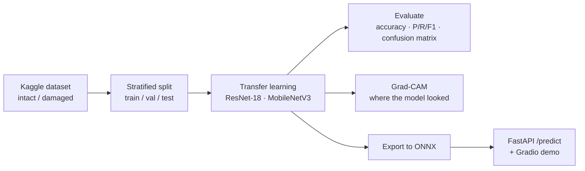
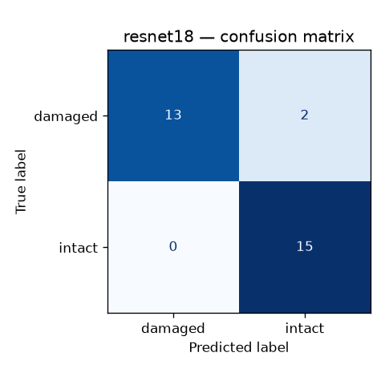
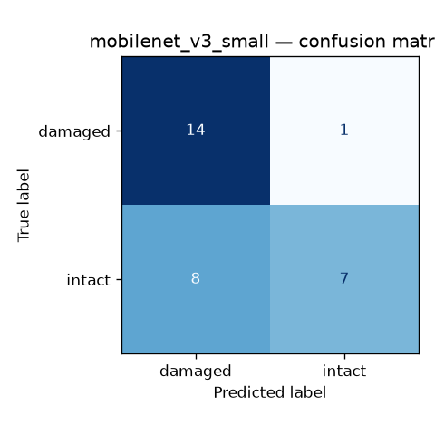
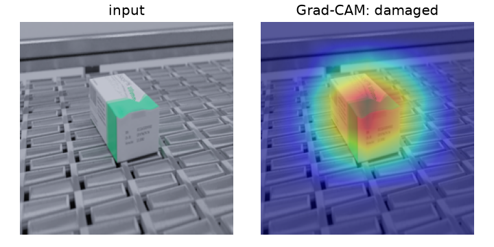
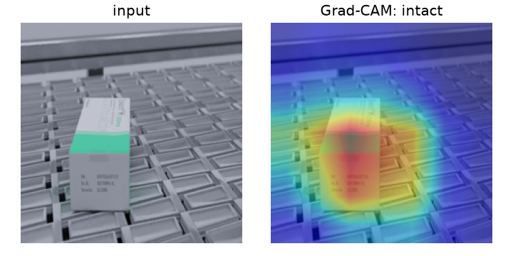

<!-- markdownlint-disable MD033 MD041 -->

# DamageScan — Parcel Damage Detection with Deep Learning

> Classify a parcel photo as **intact** or **damaged** using transfer learning
> (ResNet-18 / MobileNetV3), explain the prediction with Grad-CAM, and serve it
> through an ONNX + FastAPI endpoint with a Gradio demo.

PyTorch · torchvision · scikit-learn · ONNX · FastAPI · Gradio · Docker · GitHub Actions

---

## Why this project

In a sorting facility a camera on the belt can flag damaged parcels before they
ship. DamageScan is a small, end-to-end, **explainable** computer-vision system
that does exactly that — built to be read and defended line by line, not to hide
behind a framework.

## Pipeline



## Dataset

[**Industrial Quality Control of Packages**](https://www.kaggle.com/datasets/christianvorhemus/industrial-quality-control-of-packages)
by Christian Vorhemus (license: **GPL-2**). RGB images of `intact` vs `damaged`
packages with a top and a side view per package. **The images are synthetic**
(procedurally rendered in Blender) — this is stated honestly because the project
rule is to never pass synthetic data off as real-world photos. We train on the
**top view only**, so there is exactly one image per package and the two views
of a package can never leak across the train/test boundary.

The dataset is **not** committed (see `.gitignore`); download it with your own
Kaggle API token (below).

## Results

<!-- METRICS:START (generated from metrics.json by an actual training run) -->
Trained on the **side view** (200 images, 100 per class), split 70/15/15 →
140 train / 30 val / **30 test**, with deterministic cuDNN so the numbers below
reproduce. "Damaged" is the positive class; recall on it is what a facility
cares about (a missed damaged parcel is the costly error).

| Model | Params trained | Accuracy | Precision (damaged) | Recall (damaged) | F1 (damaged) |
|-------|---------------:|:--------:|:-------------------:|:----------------:|:------------:|
| **ResNet-18** (lr 1e-4)        | full fine-tune | **0.933** | **1.000** | 0.867 | **0.929** |
| MobileNetV3-small (lr 4e-4)    | full fine-tune | 0.700     | 0.636     | 0.933 | 0.757 |

ResNet-18 is the stronger model: **zero false alarms** on intact parcels
(precision 1.00) and it misses only 2 of 15 damaged parcels. MobileNetV3-small
is ~4× smaller and was markedly harder to train on so few images (it needed a
higher learning rate and still trails by ~23 points) — a real
accuracy-vs-efficiency trade-off, and the kind of gap more data would narrow.

Confusion matrices:

| ResNet-18 | MobileNetV3-small |
|:---:|:---:|
|  |  |

**Grad-CAM** (ResNet-18) — the heatmap concentrates on the parcel, not the
conveyor background, which is evidence the model learned the right cue:

| Damaged | Intact |
|:---:|:---:|
|  |  |

All numbers come from `metrics.json`, written by `evaluate.py`; the overlays
live in [`reports/`](reports/).

> **Honest caveat:** the dataset is small (200 packages) and synthetic, and the
> test set is 30 images, so treat the exact percentages as indicative. The point
> of the project is a correct, reproducible, explainable end-to-end pipeline.
<!-- METRICS:END -->

## Quick start

```bash
# 1. Create a virtual environment (Python 3.11) and install
python -m venv .venv && . .venv/Scripts/activate   # Windows; use bin/activate on *nix
pip install -e ".[dev,serve,kaggle]"
# GPU users: install the CUDA build of torch first, e.g.
#   pip install torch torchvision --index-url https://download.pytorch.org/whl/cu124

# 2. Get the data (needs a Kaggle API token in ~/.kaggle/)
python scripts/download_data.py --source kaggle          # real dataset
#   or, with no token / for a quick demo:
python scripts/download_data.py --source synthetic --n-per-class 200

# 3. Build a stratified split. The side view carries the clear damage signal,
#    so we train on it (one image per package, no top/side leakage).
#    (--group-by-sn instead keeps both views of a package in the same split.)
python scripts/make_splits.py --name-filter side

# 4. Train (uses the GPU automatically if available; cuDNN is deterministic)
python -m damagescan.train --arch resnet18
python -m damagescan.train --arch mobilenet_v3_small --lr 4e-4   # needs a higher LR

# 5. Evaluate, export to ONNX, and explain
python -m damagescan.evaluate --checkpoint models/resnet18.pt
python -m damagescan.export_onnx --checkpoint models/resnet18.pt
python -m damagescan.gradcam --checkpoint models/resnet18.pt \
    --images data/processed/test/damaged/*.png
```

## Serving

```bash
# FastAPI (http://localhost:8000/docs for the OpenAPI UI)
uvicorn app.api:app --reload
# Gradio demo
python -m app.gradio_app
```

| Method | Path       | Description                                   |
|--------|------------|-----------------------------------------------|
| GET    | `/health`  | Liveness + whether a model is loaded          |
| POST   | `/predict` | Image upload → `{label, confidence, probabilities}` |

With Docker:

```bash
docker build -t damagescan .
docker run -p 8000:8000 -v "$PWD/models:/srv/models" damagescan
```

## Project layout

```
damagescan/
  src/damagescan/     config, data, model, train, evaluate, gradcam, export_onnx, inference
  app/                api.py (FastAPI), gradio_app.py
  scripts/            download_data.py, make_splits.py
  tests/              preprocessing, split and API tests
  .github/workflows/  ci.yml (ruff + pytest on CPU)
  Dockerfile          CPU serving image
```

## Tests & CI

`pytest` covers preprocessing, the stratified split, and the API (run against a
tiny dummy ONNX model — no GPU or training needed). GitHub Actions runs `ruff`
and the test suite on every push and pull request.

```bash
ruff check . && pytest -q
```

## Documentation

- [INTERVIEW_NOTES.md](INTERVIEW_NOTES.md) — 20 Q&A mapped to this code.
- [RESUME_BULLETS.md](RESUME_BULLETS.md) — resume bullets from real numbers.

## Notes

The dataset and trained weights are synthetic/large and intentionally not
committed. Metrics in this README are produced by running `evaluate.py`; they
are never hand-written.
